# CUT CONTENT: Production Diary (the director's cut)

*A museum heist where the producer cut every silly idea, and you put them all back. Made for the 2026 Epic AI MegaJam
(theme: Director's Cut) by one human director and an AI crew that never sleeps, never eats, and does not take direction
nearly as well as it claims.*

> **PRODUCER:** It is a dev log. Keep it short.
> **DIRECTOR:** It is the director's cut. It is long on purpose.

**Made by:** dartkis (solo), directing AI agents. 2026 Epic AI MegaJam, theme "Director's Cut".

**The work, commit by commit:** [COMMITS.md](COMMITS.md)   ·   **What is not ours:** [SOURCED_ASSETS.md](SOURCED_ASSETS.md)

**The making-of film** (the director and the producer disagree about what happened): [CutContent_MakingOf_720p.mp4](CutContent_MakingOf_720p.mp4)

**The making-of film:** `devlog/preview/CutContent_MakingOf.mp4` (2 min 41 s: the director and the producer tell it, and disagree)

---

## The cast and crew

| Role | Played by |
|---|---|
| The Director | the human: playtests, notes, taste, the word "no" |
| The Crew | an AI agent (Claude Code) with a terminal, driving Unreal 5.9 through Python, Blender through scripts, and a bot that plays the game |
| The Producer | the weekly usage limit. Appears in every scene. Says "this was not in the budget" |
| The Thief | a MetaHuman in a hoodie. Later a cowboy. Briefly a somersault |
| The Guards | five MetaHumans in the same uniform ("we could only afford five actors, he is playing his own twin") |

---

## Scene 1, take 1: the pitch (Day 1, 12 November)

The theme was announced at midnight: **Director's Cut**. By morning the pitch was a heist film in which the producer has
cut every fun feature, and the deleted scenes lie around the museum as film cans. Pick one up, the feature comes back:

- **THE FLUSH**: climb into a toilet, ride the pipes, pop out somewhere else. (Cut from a real prototype of ours at
  2 AM. It is the only feature the producer was right about.)
- **CUT!**: yell it and the whole set freezes.
- **TAKE 2**: the world rewinds five seconds. You do not.
- **STUNT DOUBLE**: a cardboard thief. Security walks over to have a word with it.

> **DIRECTOR:** And the director and the producer argue in your ear the whole time.
> **PRODUCER:** About money.
> **DIRECTOR:** About art.

By lunch there was a C++ module, a level built by a Python script, guards with torches, lasers, and a toilet that was
an exit. By evening the first packaged build passed its own self-test (12 of 12) and the first human playtest returned
nine notes ("he runs everywhere", "there is a wall in front of the toilet", "I do not know where to go"). All nine
were fixed the same hour.

## Scene 2, take 7: the night shift (Night 2)

The director's brief before bed: *"Fix the bugs, make it look great, make it bigger, more gameplay, don't forget the
comedy. Back at 9."* The crew built:

- **The Film Archive** under the museum ("there is no basement in the script"): JUMP CUT (put your mark down, cut back
  to it from anywhere), a time-locked negative cage that ignores CUT and TAKE 2, a projector that lures the old hand away.
- **The Alley**: a police drone. It is a hobby quadcopter with the producer's torch taped underneath. Its loudspeaker
  makes small talk. It falls for the cardboard double ("Suspect located! ... Suspect is... cardboard.").
- **The comedy pass**: the flush got its own camera, guards feel a draft after a CUT and deja vu after a TAKE 2, the
  commentary notices when you stand about or hop.

> **PRODUCER:** We said one heist.
> **DIRECTOR:** It is one heist. It just has a basement.

## Scene 3, take 12: the studio (Day 3)

**Sound Stage B** (painted flats of every film the producer cut, and **MONTAGE**: the world fast-forwards eight times,
you do not, nobody gets caught in a montage). Then the director said the words every crew dreads:

*"Add more gameplay. More scenes. But don't add more buttons: E, J, M, there are already letters all over the
keyboard. Actually, that could be a joke. Make it more like Hitman."*

So everything after that is on **one key**, and the joke is in the game: a film can labelled *DOUBLE JUMP* that
cannot be restored, because there are no keys left on the keyboard.

> **PRODUCER:** There are no keys left on the keyboard.
> **DIRECTOR:** There is F13.
> **PRODUCER:** There is no F13.
> **DIRECTOR:** Not with that attitude.

The sandbox acts, all on E:

| Scene | The trick |
|---|---|
| **The Backlot**, a western street of false fronts | One gate, one guard, four ways past him: put on a cowboy costume (nobody looks at an extra), fog the street, put a record on the saloon gramophone, or fast-forward to his smoke break. Hide in a wardrobe or a prop coffin. Front doors are scene cuts to the back of the set |
| **The Picture Palace** | Take the follow spot, aim it into the usher's eyes, let go: the beam stays until the bulb blows. Or play the theatre organ and let him hunt for the phantom |
| **The Foley Stage** | Gravel, glass and dry leaves wall to wall: every step is heard. Tiptoe. The mixing desk plays footsteps through a speaker in the far corner |
| **The Stunt Hangar** | An air ram throws you over a castle wall in a somersault. Or the wire: nobody ever looks up |
| **The Scene Dock** | A man at the far end watches the whole hall. Push a scenery flat on castors and walk behind it. "Was that wall always there?" |
| **The Creature Shop** | One big red button. The rubber dinosaur wakes up, security runs screaming for the corner |

Fourteen scenes at that point (twenty-three by the end, see scene 6), eight lost reels of footage hidden around the set, thirty-seven things to fool around with,
fifteen director's notes to earn.

## Scene 4: the effects department

Particle effects were built the way everything here was built: by script. Thirteen Niagara systems (lightweight
emitters, every module set from Python, nobody opened the Niagara editor): water when the toilet slurps you, a geyser
when it spits you out, film scraps for a JUMP CUT, sparks from the alley's tubes, smoke from the fog machine, musical
notes out of the gramophone, moths round the porch lamps, confetti for the wrap.

## Scene 5: the animation department (we did not have one)

The sample's animations cover walking, running, climbing. They do not cover hanging from a zip line, tucking into a
somersault, or pushing a wall on wheels. The director noticed every time:

- *"When he jumps on the air ram his legs fly apart."* (The foot IK was trying to stand on a floor that was five
  metres below him.)
- *"On the zip line he is in his idle pose. His hands must be on the line, from every angle."*
- *"He pushes the wall and just walks normally."*

So the crew wrote animations without an animation program: a script reads the sample's poses bone by bone and stitches
new ones together. The arms from a cliff catch and the legs from standing make **A_CC_Hang**; the arms from a fall and
the knees from a crouch make **A_CC_Tuck**; the shoulders from a shove and the legs from a walk make **A_CC_PushWalk**.
The zip line got a real trolley whose handlebar is placed in the thief's fists every frame.

> **DIRECTOR:** We are an animation studio now.
> **PRODUCER:** We are a toilet studio with ambitions.

## Scene 6: the director watches the dailies (the night before the last day)

The build was packed, the trailer was cut, the crew had its coat on. Then the director played it properly and sent
one message with nine notes in it. Every one of them was right, which is the worst kind of note.

- *"In the mirror you cannot see him from every angle."* The mirror was a polished material, and without ray tracing
  that only reflects what is already on screen. The thief vanished from his own reflection whenever the camera could
  not see him. Now a second camera stands behind the glass where his reflected eye would be and films the room
  through a frustum cut to the edges of the mirror.
- *"I cannot hear what they say. There is some constant filming noise, sounds keep cutting in, and if you walk a
  little too far it says what came before and never gets to the next thing."* The best suspect for the filming noise was the music: the
  heist theme had a clock ticking on every eighth note. The theme is a walking double bass now. Every sound got a
  class, the mix steps back when somebody talks, and a newer exchange takes the place of older lines still waiting.
- *"Some of the sounds are nasty AI beeps."* They were sine waves, and they sounded like sine waves. The effects are
  rebuilt on a few recorded sources (a latch, a book, a knife, a switch) with plucked strings where a note is wanted.
- *"Nobody understands the guards. Sometimes you run past them, sometimes you cannot. Redo the AI on a behaviour
  tree."* The guards are a behaviour tree now, with a branch for each mood and the urgent ones interrupting the rest,
  and they got one new habit: a man on his rounds who loses you walks over to where he last saw you and looks about.
- *"The air ram is still awful. Redo it from scratch, properly."* Takes one and two moved the thief along a curve by
  hand and posed him by hand. Take three does neither. He walks onto the plate, the valve hisses, the plate kicks,
  and from there it is his own physics, his own falling and landing, and the player's own camera.
- *"Some things you walk straight past and never know you were meant to take."* Everything you can pick up now stands
  under a beam of light and shimmers when you are near.
- *"At least five more scenes, each with a trick of its own."* See below.
- *"It looks cheap."* Also see below.

The crew added one thing nobody asked for: the guards' view cones drawn on the floor, tidy and colour-coded.

- *"No AI field of view on the floor. It looks terrible."*

It lasted under an hour. It was a very clean implementation.

> **PRODUCER:** You built it and deleted it inside the hour.
> **DIRECTOR:** That is called a director's cut.

### Five more scenes

All on the one key, each with a trick the others do not have:

| Scene | The trick |
|---|---|
| 14, the prop store | Stand still among the mannequins and you are one. Move and you are a thief again |
| 15, the cutting room | There are no doors: the director cut them. A match cut takes you from a shape to the same shape |
| 16, the fly loft | Every rope on the wall holds a sandbag. Wait until he stands on the mark |
| 17, the weather stage | Start the rain. In the rain nobody hears you run, and nobody sees far |
| 18, the green screen | In the green suit, in front of the green, you are not in the picture. Off the green you are a very green man |

> **PRODUCER:** Why do we own four hundred mannequins?
> **DIRECTOR:** Crowd scenes. They never ask for lunch.

The director read the list and answered in three words: *"Let's have four more."*

| Scene | The trick |
|---|---|
| 19, the lighting stage | The dimmer board kills every lamp in the hall. In the dark they see three metres, and the man on the door goes to find the switch |
| 20, the breakaway shop | Some walls are made to be walked through. Everybody hears a wall, so he comes to look at the hole |
| 21, dispatch | A crate, a conveyor, a lamp over the hatch. Ship yourself on green; on red they open the crate |
| 22, the extras | Four extras dressed as guards, in the cowboy hats from the last picture. Walk in step with them and nobody tells you apart |

The extras are the guards' own code with one switch thrown: sees nothing, hears nothing, says nothing. The first
version asked the thief to walk exactly between two of them; a step out of place and he was a thief again. The test bot
could not do it, and a bot is more patient than a player. The crowd is roomier now.

> **PRODUCER:** Why are the extras dressed as guards and wearing cowboy hats?
> **DIRECTOR:** Two films. One wardrobe budget.

That makes twenty-three scenes. The getaway, which was scene fourteen two days ago, is scene twenty-three.

### Watching the whole film

The director's last note of the night: *"When you are done, play it through the way a person would, with screenshots,
and look for defects."* So the bot walked all twenty-three scenes while a second process took a picture of the screen
every five seconds, and the crew read the 170 pictures like a tester's notebook.

- **The title card came late.** "CUT TO: THE BREAKAWAY SHOP" appeared ten seconds into the breakaway shop, after the
  scene had already introduced itself. Cards go to the head of the line now.
- **The hero went white in doorways.** His key light rides beside the camera, and when the camera was pushed up
  behind him the light was a hand's width from his hoodie. It now gives the same light at any distance.
- **The archive's shelves were rippling.** The surface-detail script read "Shelf" in a material's name, decided it was
  wood, and gave painted steel panels a wood grain a metre wide. Paint is paint now, whatever is under it.
- **The green suit was a grey checkerboard.** The material had never been compiled for a body, so the engine drew its
  "something is wrong" pattern instead. A packaged game cannot fix that by itself; it would have shipped that way.
- **The fly loft was one colour.** Red walls, red curtain, red floor from the bounce. Backstage is black timber now and
  the curtain is the red.
- **Red mannequins on a red carpet.** Nobody could count them, least of all the producer.
- **The sign on the rain valve said NIAR.** It faced the wall.

None of these fail a test. All of them are the first thing a person sees.

### Screen tests for the guards

*"Don't forget to test the AI."* The complaint that started the night was that the guards felt random: sometimes you
ran past, sometimes you could not. So there is now a room nobody can walk into, the screen-test stage, with one guard
on a post and one on a round and nothing else in it. A bot puts the thief somewhere, shows him for a measured time,
hides him again and reads from the log what the guard made of it, three times each.

| The thief | The guard | Three runs |
|---|---|---|
| Four metres in front of him | Sure | 0.42 s, 0.43 s, 0.42 s |
| Nine metres in front of him | Sure | 0.92 s, 0.91 s, 0.93 s |
| Nine metres, crouched | Sure, later | 1.56 s |
| Further than he sees, or 45 degrees off his nose | Nothing | never |
| Walking past three metres behind him | Nothing | 0 of 3 |
| Running past three metres behind him | Hears it, turns, sees him | 3 of 3 |
| Running past seven and a half metres behind him | Nothing | 0 of 3 |
| Right behind him, at arm's length | Knows | 0.34 s |
| A glimpse, then gone (a man on a round) | Looks, walks over, gives up, goes back to his round | |
| A glimpse, then gone (a man on a post) | Looks, stays on his post | |

So the guards were never random; they were unreadable, which to a player is the same thing. The test also caught one
rule nobody had chosen: the man on the round heard the thief running on the other side of a solid wall and turned to
face it. A wall halves how far a run carries now.

> **PRODUCER:** You watched your own film and gave yourself notes.
> **DIRECTOR:** Somebody has to.

### Why it looked cheap

Three reasons, found by looking at screenshots instead of at code:

- **The hero was a black cut-out in every single shot.** He had two lights of his own, a key and a rim, and they had
  not lit anything since they were moved onto the camera. They were attached to the camera manager, which is a hidden actor, and a hidden
  actor's lights do not shine. Nobody noticed because nothing failed: the lights were there, in the right place, at
  the right brightness, switched on, and dark.
- **Every wall was one flat colour.** The levels are boxes with one-colour materials. A script now gives every
  flat material a world-aligned surface (plaster, wood grain, weave, brushed metal by the material's name), blotches
  in the colour and speckle in the shine.
- **Things stood in each other.** A script now measures every pair of props for overlap. It found a table inside a
  wall, a crate inside a pallet and a pair of doors that shared fourteen centimetres.

## Scene 7: the set dressers arrive (the last evening)

> **DIRECTOR:** I watched it again. Thirteen of my scenes are shot in a shoebox.
> **PRODUCER:** Shoeboxes are in budget.
> **DIRECTOR:** Then get me set dressers. And find out who is eating my frames.

### Who was eating the frames

The game ran at thirty frames a second in the editor in every scene, heavy or empty. The same number everywhere
means it is not the picture. A profile of one frame said where the time went:

| | Before | After |
|---|---|---|
| Things ticking every frame | 951 | 188 |
| Actor ticks | 7.9 ms | 1.8 ms |
| Character movement | 2.7 ms | 1.0 ms |
| The frame (editor, while recording) | 29.8 ms | 22.1 ms |

Forty-six people are on the lot. Each is the animation sample's full character: a blueprint that ticks, a movement
component, six hair grooms, a spring arm and three cameras. Yesterday's "sleep" hid a far guard and stopped his
skeleton, and left all of that running, for a man three rooms away behind four walls.

- A sleeping guard now thinks and walks ten times a second instead of every frame, and his hair and cameras do not
  tick at all. He still walks his round: the bots' routes depend on where he is when the thief arrives.
- A guard goes to sleep when he is far, or when he is more than twenty-two metres off **and** a wall of the set
  stands between his head and belt and the camera. Only the lot's own opaque walls count. Glass does not hide a man.
- Nobody looks through a guard's cameras. They are switched off for good.
- The build's self-test used to time five places we thought were heavy. It now walks all twenty-three scenes and
  writes the frame rate looking each way, the worst frame, and the worst frame of the arrival.
- The pause card has a picture setting: PREMIERE, MATINEE, DRIVE-IN. The two cheaper ones draw fewer pixels and
  lighter shadows. Global illumination stays on in all three, because without it every room goes flat.

### The shoeboxes

Scenes 10 to 22 were boxes: four flat walls, five lamps with no fittings glowing on a ceiling, an empty floor. One
script (`tools/ue_scripts/dress_lot.py`) now dresses all thirteen as soundstages:

- steel columns every six metres, a skirting, a rail at three metres, quilted sound blankets above the rail;
- a black roof with beams across it and a pipe grid under them;
- six lamps on the grid in each room, with housings and lit lenses, throwing pools of light on the floor instead of
  blobs on the ceiling; four of the six are lit and cast shadows, and half of those draw shafts in the haze;
- the crew's kit along the walls (cases, crates on pallets, barrels, costume racks, mask racks, lockers);
- posters, notice boards, extinguishers and wall lamps at eye height, air conditioning higher up;
- a yellow line on the floor a pace in from the walls.

About 2,100 pieces in all. None of them is placed by hand and none is in the way: every piece is tested against
what already stands in the room, the guards' rounds, the arrival and exit of the scene, the path of everything that
moves (the flats on their rails, the conveyor, the sandbags), and every spot and route the playtest bots use, which
the script reads out of the tests themselves.

| Before | After |
|---|---|
| 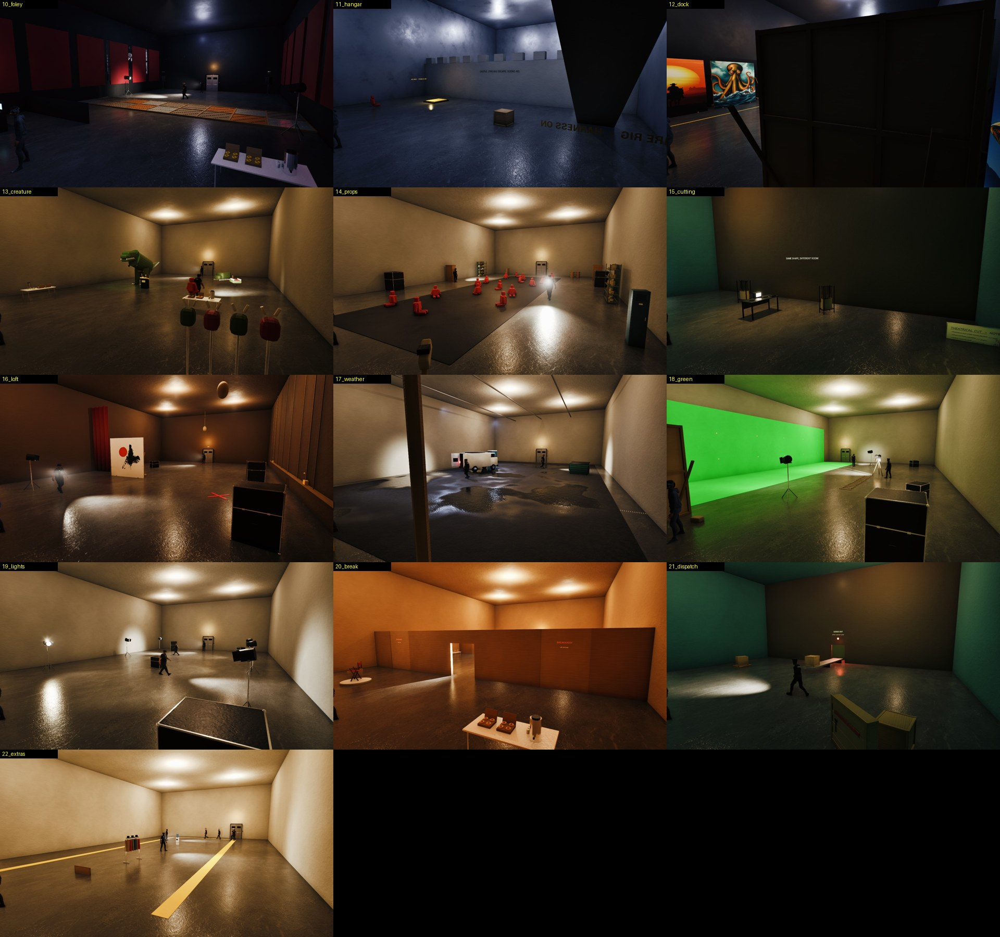 | 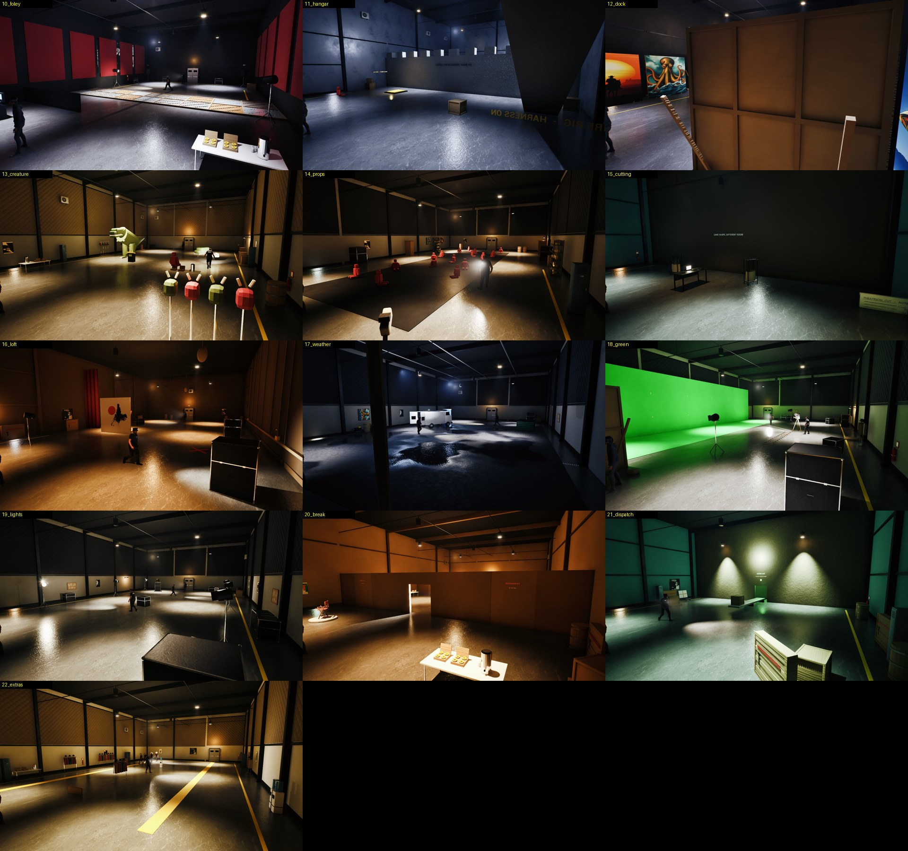 |

The lamps in the lighting stage go dark with the dimmer board, lenses included.

## Scene 8: the other films (the last night)

At midnight the director came in with four links: other films in the same festival. "Analyse them. Then be better."

### Reading the other posters

We read the jam's entry list (109 entries when we looked) and the pages and stills of twenty-four of them. We did
not play them: a page and its stills is what a judge sees before deciding what to download, so that is what we judged.

- Most entries are small: one set, four to fifteen minutes. Ours has twenty-three scenes, and a judge with ten minutes
  would have seen three of them.
- The best-looking ones have dense sets and a look of their own. Our lot halls were large and half empty, and the
  prop store's mannequins were red boxes with heads.
- The weakest picture in our own film was its first room.

That last one decided the night's order of work.

### The first room

Scene 1 is the first thing anybody sees, and it was a lit box: bare grey walls, and two lamps with no shadows filling
it evenly. One script (`tools/ue_scripts/dress_annex.py`, 143 pieces) makes it a museum's service corridor after
hours:

- two-tone institutional walls: bottle green gloss below a rail, cream above, a dark service band under the ceiling;
- beams and a ventilation duct overhead, door casings, doors folded back against the wall;
- pools of light under the tubes with real shadows, a warm lamp over the guard's desk, a soda machine glowing in the
  dark (out of order), a lit EXIT box, the lock's red eye;
- two painted lines on the floor: red to the gallery, blue to the restroom. It is the level's first lesson, and nobody
  has to say it;
- moonlight from the gallery through the panes of its door, thrown across the floor.

The moonlight is a cheat. A lamp on the far side of the door would light the gallery too, so it hangs on our side,
and the panes are a lattice in front of it that only that lamp knows about: hidden in the game, casting a shadow all
the same, on a lighting channel of its own so that no other lamp throws its shadow on the ceiling.

| Before | After |
|---|---|
| 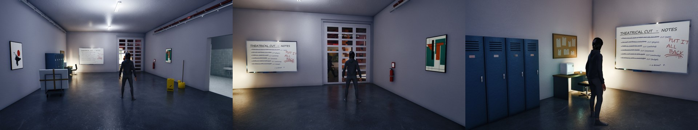 | 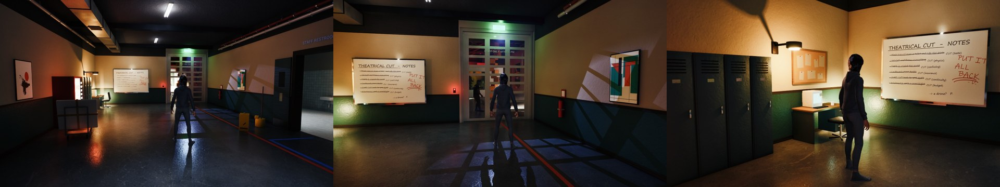 |

### The basement

The film archive had the museum's white on every partition and a ceiling of shadowless tubes: blown-out walls, no
shape. `dress_archive.py` paints the partitions slate blue below a rail and a tired cream above, and turns each of the
thirteen live tubes into a pool of light with a soft glow round it. The two-tone took one trick: every wall piece is
wrapped in a box a centimetre bigger than itself, so door reveals and wall ends come out right without anyone working
out where the doors are.

| Before | After |
|---|---|
| 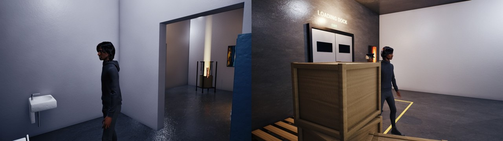 | 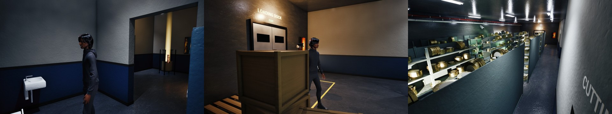 |

### Four hundred mannequins

"Four hundred mannequins. I counted. I had to sign for them." They were red boxes. They are the animation sample's
mannequins now, in shop-window plastic (white, black, one gold), each holding one frame of an animation. Most hold the
raised arm the thief holds when he passes for one of them; a few are caught walking, falling or shoving. They take
their pose in the first second and a half of the level and their skeletons are then stopped for good, so each costs a
draw and never a tick. A hidden post stands inside each one for the thief and the guards to walk round. A few wear hats.

### What hangs over a stage

The director looked at the halls again: "Still empty." The floors have to stay empty, because that is where the game
is played. The air does not. Each hall now flies what a stage flies (`flown()` in `dress_lot.py`):

- painted cloths on wires between the lamp rows, each with a lamp of its own on it, painted on both sides;
- a lit box with the stage's number and name, read from both ends of the hall, dark with the dimmer board;
- in the cutting room, thirteen light tables on the black partitions with the day's trims hung over the glass, and
  more trims on rails overhead with a lamp on each;
- in the creature shop, the monster's spare heads on chains;
- where things are stored (the dock, dispatch, the hangar, the breakaway shop), crates three high.

Film lamps on stands, cameras on tripods and stored flats (a different picture on each) joined the kit along the walls.

| Before | After |
|---|---|
|  | 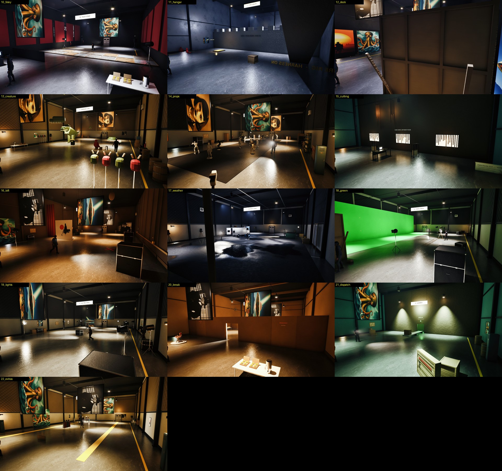 |

### The flip book

"Fix the animations." Which ones? `tools/anim_review.py` films one move at a time from a fixed camera at six or
eight frames a second and lays the frames out in rows: walking, running, sneaking, turning, the flush, the air ram,
the wire, a guard on his round. Read like a flip book, the locomotion (the animation sample's motion matching) and the
stunts held up. Two things did not:

- Nobody reached for anything. The thief pressed buttons, read whiteboards and opened lockers by standing near them.
  Every use now puts a hand out first (`A_CC_Reach`: the shove's right arm on a standing body, built bone by bone
  like our other poses). Standing only: the gesture is a whole-body pose, and legs stopped in mid-stride slide.
- The thief who passes for a mannequin raises one arm. The new mannequins stood in the reference pose, arms out,
  like a row of men being measured for suits. They hold his pose now (see above).

### Scene selection, whole from the first launch

The title card already had a scene selection, but only for scenes the player had reached. A judge on a fresh install
had none. Now a first-arrival save of every scene ships with the game (the bot writes them when it plays the whole
film, `tools/scene_saves.sh`), and the game falls back to the shipped one when the player has no save of his own for
that scene. The shipped saves are somebody else's run, so their retakes, statistics and found reels are not handed on.

The pause card got a third line: V steps the sound down a quarter at a time.

### The film about the film

The director wanted the dev log as a film too, cut from the recordings, "and the director and the producer should
tell it, and argue about what happened". The recordings are thirty hours of an editor window (52 files), with whatever sound
the machine was making at the time, so the sound was thrown away and written new.

- **The script** is forty lines (`devlog/tools/making_of_script.py`), each with the shots that go under it. The
  first cut had twenty-four; the director watched it and said "more jokes", so sixteen more went in, every one of
  them a blooper from this diary.
  The producer corrects the director where the director improves on history: "I pitched a grim, realistic museum
  heist." "No, no. You said: he flushes himself down a toilet."
- **The voices** are made the way the game's are: Chatterbox for the director, Kokoro for the producer. Whisper then
  listens to every line and compares it with the script. It caught three: "eight takes" had come out as "a take",
  three zeros as four, and the producer's last word, "Cut.", as "God."
- **The picture** is the game view cut out of the recordings, with the date of each shot printed over it: the template
  of the first hour, the grey corridor the producer approved, take eight at the lasers, the archive at two in the
  morning. The voices set the length of every shot; nothing is timed by hand.
- **The last playthrough** is not from the recordings. The director had switched the recorder off (he does when he
  uses the machine himself), so the bot's final run was filmed separately, picture only.

The director watched that run and said: "He walks straight past the guards and nobody sees him." True: the walking
bot tests doors, routes and timings, and for that test the guards are told not to see it (their eyes have a screen
test of their own). The film says so on screen, and the line about the guard is cut over his screen test instead.

### What a judge's machine can show

The slowest place in the film is the museum's own gallery, and it is the first real scene. On the build machine it
runs at 47 frames a second; on a judge's laptop it could be a slide show, and the setting that fixes it sits on the
pause card where nobody looks first. So on a first launch the game now watches itself: three seconds of frames behind
the title card (which turns round the vault, about as heavy as the film gets), and if the middle one is under 45 a
second the picture goes one step down and is looked at again.

The first version of that rule had a hole, and the test for it found a second one. A display that caps the frame
rate at 30 would have been handed the worst picture for nothing, so a step that buys no speed is taken back. Then the
test fed it "30, then 43, then 43" and it went all the way back to the heaviest setting instead of one step: it goes
back to the last step that helped now. It is tested in the editor by capping the frame rate
(`tools/test_probe.py`); it has not yet met a real slow machine.

### The monster, second casting

The rubber dinosaur was cylinders and boxes, and the masks beside it were cubes on sticks. `tools/blender/make_creature.py`
grows them the way a rubber toy is made: round masses along the spine, the tail and the snout, melted into one skin
(a voxel remesh), smoothed and thinned out. The neck and the jaw hinge are exactly where they were, so the code that
turns the head and works the jaw never noticed.

| Before | After |
|---|---|
| 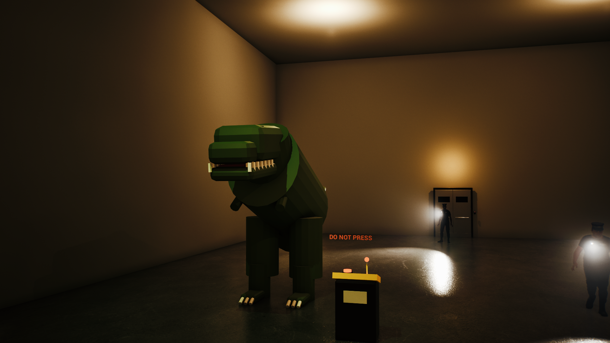 | 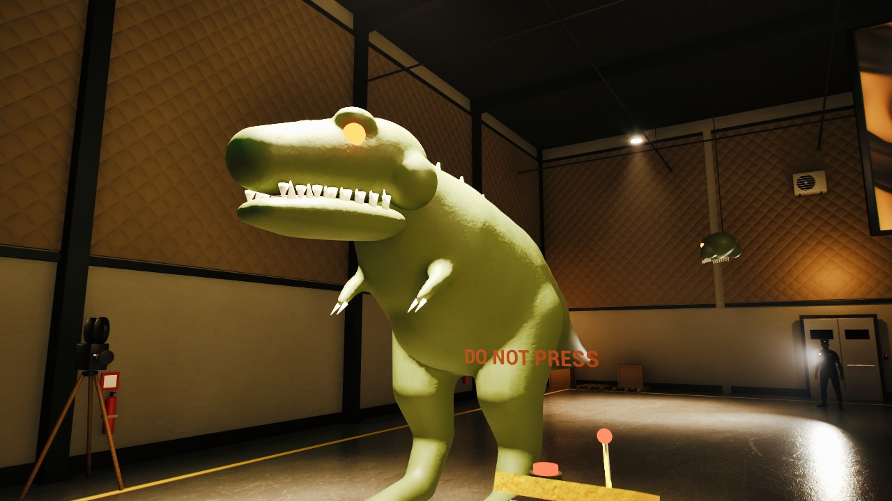 |

### The print

Build Day7b went out of the editor at half past four in the morning of the last day (Day7a, an hour and a half
earlier, was the first print of the night).

- Twenty-one bot playtests green on the final level, among them the one that walks all twenty-three scenes.
- The packaged game's own self-test: 0 fails. It now also checks that all twenty-two scene saves for the scene
  selection are inside the package, and visits every scene: 47 to 98 frames a second on the build machine, the
  slowest being the museum's own gallery (47), the vault (55) and the archive (57). No frame longer than 25 ms.
- What the last night cost (measured on Day7a): the old build and the new one ran their self-tests back to back,
  once each. The gallery
  came out the same (61.6 and 61.7 frames a second), the archive and the alley 2 percent slower, the sound stage 8
  percent and the backlot street 12 percent slower (83 to 73). One run each: a measurement, not a law.
- Not yet done when this was written: a human playing this build from start to finish.

## The blooper reel (things that went wrong)

- **The camera flew through the ceiling.** The somersault spun the whole character, and the camera was attached to
  him. Now only his body turns.
- **Guards walked into walls and stood there, forever.** Patrol routes are written in the guard's own frame; a guard
  turned 90 degrees walked his route sideways, into the wall. Affected four scenes, found by watching who never moved.
- **The usher next door stole the lure.** A speaker on the foley stage called "the nearest guard who answers lures",
  and the nearest was in the cinema next door, through a wall, with no way round. Now a guard only takes a lure he can
  walk to.
- **The thief sank into the crash mat.** It was a very soft mat. It had no collision.
- **A guard ran from the monster, then stopped after one step.** The code that ends a chase saw a running guard and
  helpfully stopped him.
- **The test bot reported the thief at (0, 0, 0).** The engine leaves zero coordinates out of the text, the test
  read the gap as "nowhere".
- **The bot walks in straight lines,** like a producer through a budget meeting. It walked into scenery. The trailer
  is staged shot by shot for that reason.
- **The valve that could not be turned.** The rain machine's valve stood next to its water tank. The tank's collision
  is one big box, the valve was inside it, and the key did nothing. The valve stands a few metres away now.
- **The mirror showed the wrong room.** With one render option switched on, the glass showed a zoomed-in corner of
  the room with a sliver of the thief in it. The camera behind the glass was seeing the right thing all along: that
  was found by saving what it saw to a file and looking at it, and the option was switched back off.
- **The film had no star.** One evening every playtest failed at once: the pause card never came up, nobody could
  crouch, a walking thief was heard like a runner. There was no thief: the play session had started with the
  engine's spectator option set, and the player was a floating camera. Why it was set we never proved. Our best
  guess is that the editor believed Ctrl was held while the director typed in another window; an editor restart
  cleared it before anyone could check. The game now ignores the spectator option (that guard has not yet met the
  fault it was written for). There is no spectator in this film.
- **The black slabs.** The first flown cloths were painted on one side. From the far end of a hall a cloth's back is
  what you see, and an unlit black square four metres wide hanging in the air is not set dressing. Both sides are
  painted now.
- **The camera that would not stop filming.** The script that films the bot's playthrough stopped its recorder with a
  polite signal the recorder never received. The playthrough took fourteen minutes; the recorder went on photographing
  an idle editor for an hour and a half, one frame every six seconds, 961 frames. Recordings end themselves now.
- **The tape measure hit the desk.** The script that paints the first room measures where the museum's wall is by
  firing a line at it. One line was fired at desk height, through the guard's desk. The east wall's paint was hung in
  the middle of the corridor, two and a half metres from the wall.
- **Scene 12 was the alley.** The first test of the shipped scene saves opened scene 12 and arrived in scene 23. The
  saves had been copied from the director's own save folder, where a file from day two was still lying about, from
  when the film had twelve scenes and the alley was the last. A scene keeps its first save for good; that was the
  point of them. The shipped set is written by a clean run now.
- **The sleeping guard who crawled.** A guard nobody could see covered thirty-seven centimetres in fifteen seconds,
  and the guards' screen test noticed he was late. Making far guards cheap had put their legs and their route
  planner on two separate ten-a-second clocks; our explanation is that the clocks drifted, the legs ticked with no
  orders and braked. We could not make it happen by hand. The planner ticks every frame again and the screen test
  has passed since, which is evidence, not proof.

## How it was made (for the Glass Box)

- **The director** played every build and wrote notes; every note is quoted above or in the git history.
- **The crew** (Claude Code) drove Unreal 5.9 through its Python and MCP interfaces: 63 prompts from the director,
  about 3,700 tool calls by the agent across the jam, 87 commits.
- **Code:** about 13,000 lines of C++ in one game module (the director, the guards, every set piece) and 180 tool
  scripts: level builders, a Blender prop factory (92 props), the material and Niagara builders, the trailer
  director, the bot playtests.
- **Levels** are built by scripts, scene by scene, and rebuilt from scratch whenever something changes.
- **Sound**: 52 sound effects, ambiences and music cues generated by Python (numpy), the effects built over a few
  CC0 recordings (Kenney) since the director called the first, all-synthetic pass "AI beeps". **Voices**: 593
  lines of local TTS (Chatterbox for the director, Kokoro for the producer and the guards), spot-checked by speech
  recognition (Whisper).
- **Testing:** nineteen bot playtests drive the real game through console commands and read its event log: a full
  playthrough of all twenty-three scenes, one per act, a chaos test that mashes every feature at random, every gag, the
  scene select. They run after every change.
- **The trailer** is recorded from the running game: each shot is staged by a script (teleports, cameras, the game's
  own interactions), captured with ffmpeg, cut and mixed with the game's own music, effects and voices.

## The cutting room floor (we cut things too)

| Cut | Why |
|---|---|
| Gnomes | Too many gnome games this year |
| Mannequin disguise | Became the cowboy costume on the backlot |
| A runtime AI director that improvises lines | Needs keys in the build; the voices are pre-generated |
| DOUBLE JUMP | No keys left on the keyboard. It is in the game as a deleted scene that cannot be restored |

> **DIRECTOR:** And... CUT! That is a wrap, everyone!
> **PRODUCER:** I am never working with you again.

---

## Stills and loops

| | |
|---|---|
| 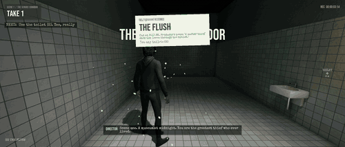 | 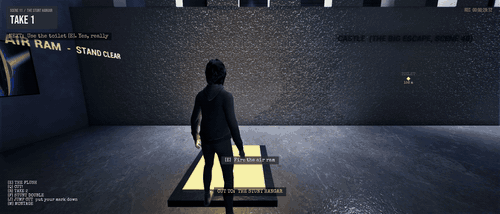 |
| 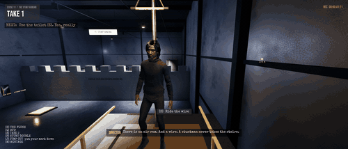 | 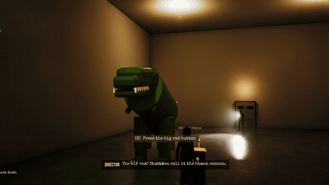 |
| 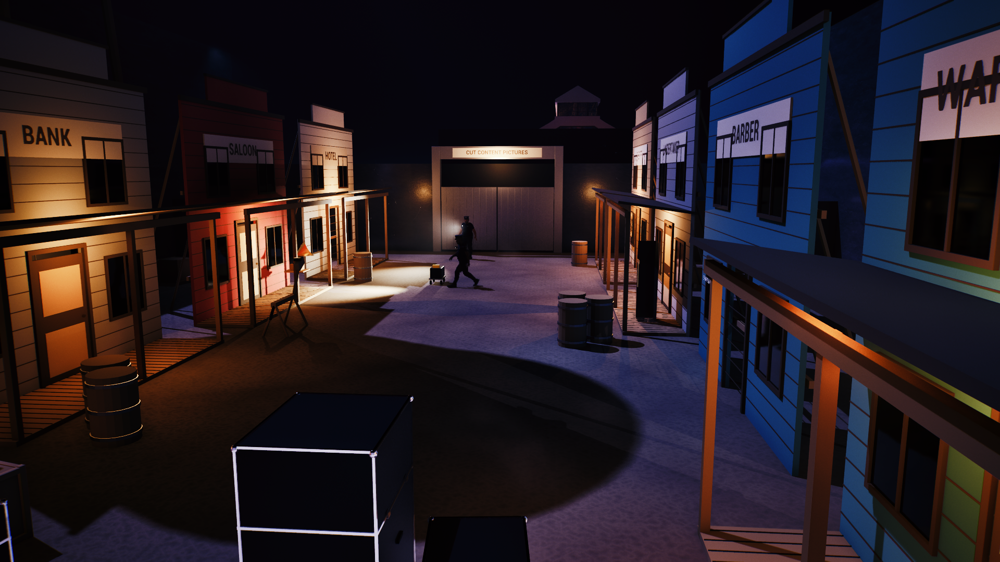 | 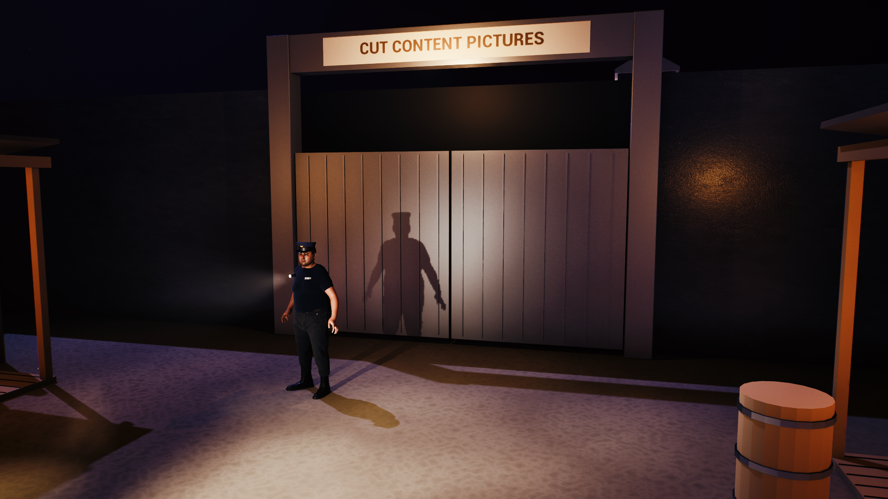 |
| 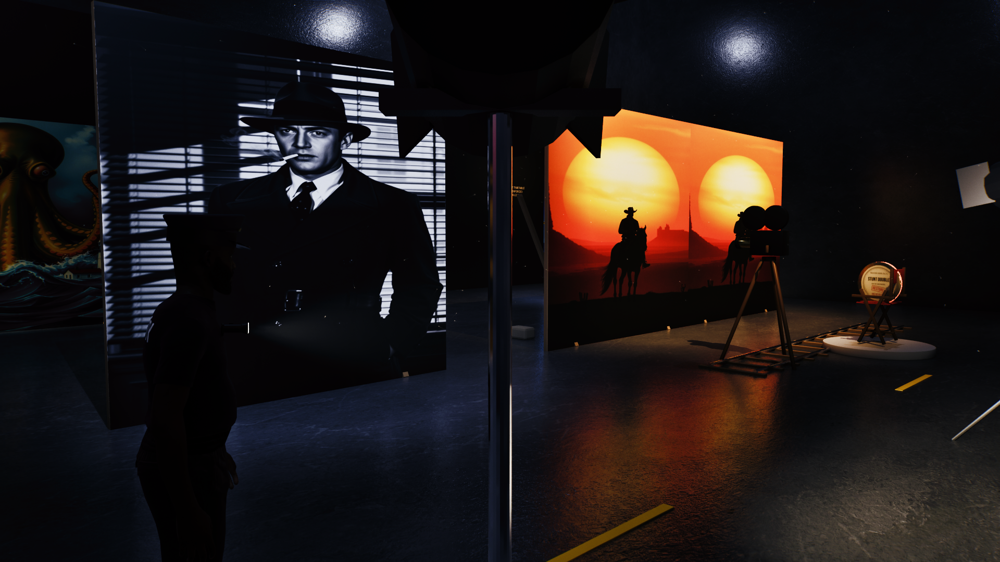 | 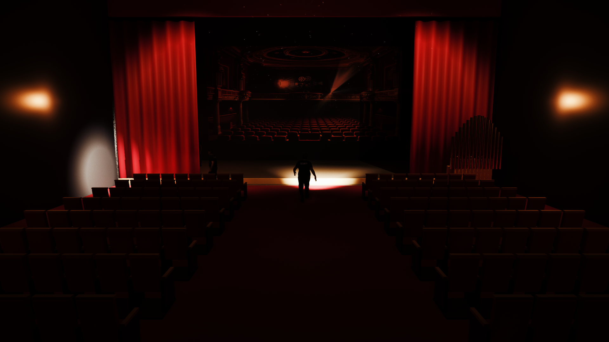 |
| 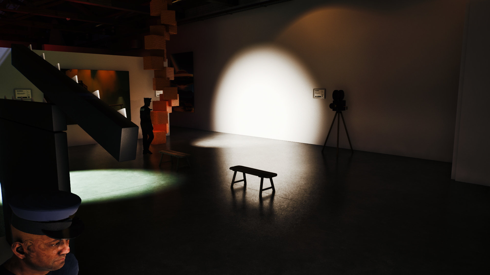 | 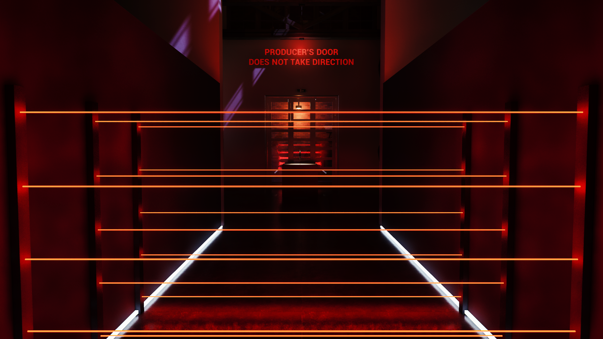 |
|  | 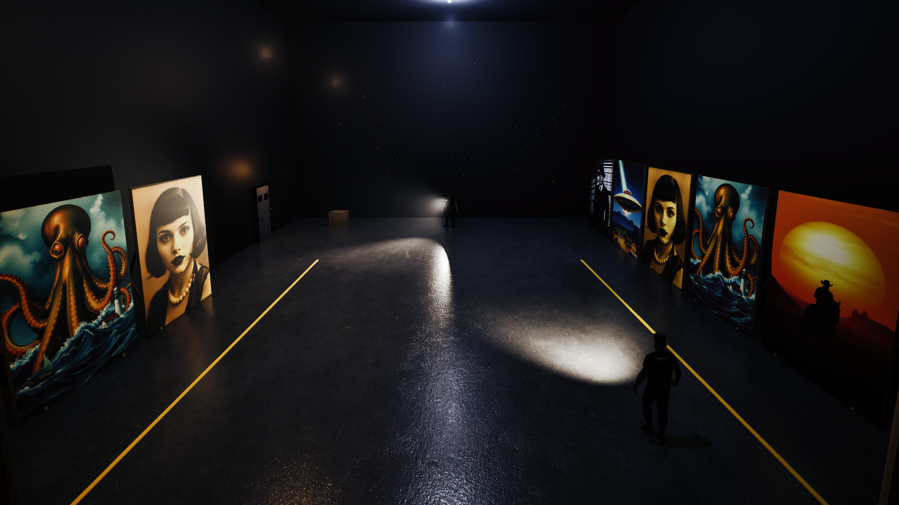 |
